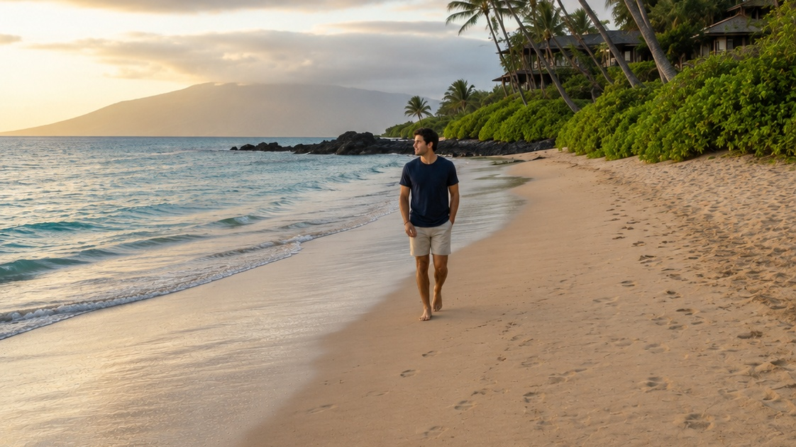
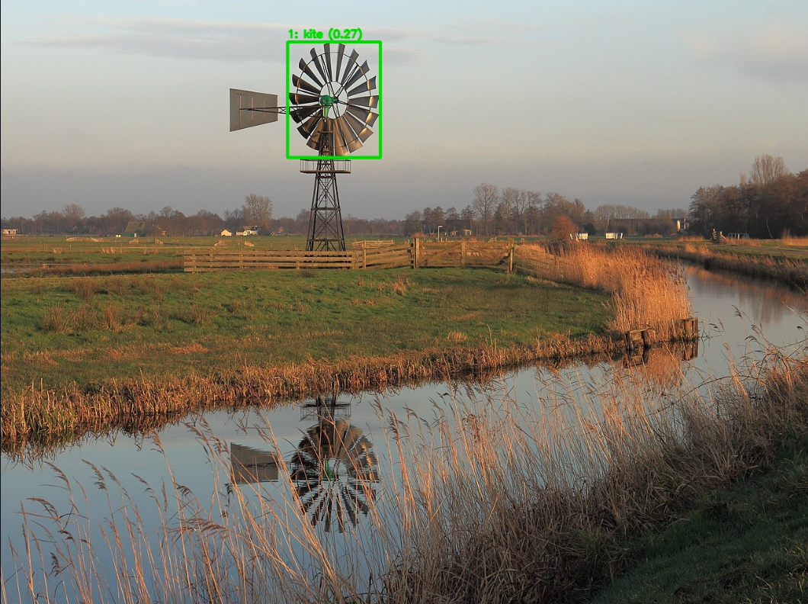

# 📸 Smart Photo Cropper

Automatically crop photos around a detected subject while preserving a user-defined aspect ratio.

The application uses **YOLOv8** to detect objects in an image, then computes a crop that:

- Maintains the requested aspect ratio
- Keeps the selected subject centred and fully visible
- Applies as much padding as possible without exceeding the image boundaries

A **Streamlit** interface lets users upload an image, choose an aspect ratio and padding, select a main subject when multiple objects are detected, preview the result, and download the cropped image.

## Features

- **Multi-class object detection** using a pretrained YOLOv8 model
- **Multiple-object selection:** when several objects are detected, the app displays numbered bounding boxes and class labels on the original image
- **Configurable object limit:** choose how many of the largest detected objects to display for selection
- **Automatic cropping:** crops immediately when exactly one object is detected
- **User-selected subject:** when multiple objects are detected, crops around the selected object
- **No-detection handling:** warns the user and displays the original image without generating a crop when no objects are detected
- Supports the aspect ratios 1:1, 2:3, 3:2, 4:3, 3:4, 4:5, 5:4, 9:16, and 16:9
- User-adjustable padding around the subject
- Automatically reduces padding when the requested amount is not feasible while keeping the subject centred
- Download the cropped image directly from the web app

## Workflow

```text
Upload original image
        ↓
YOLOv8 detects objects and their classes
        ↓
No objects? ── Yes ──> Display original image and show a warning
        │
        No
        ↓
One object? ── Yes ──> Crop automatically
        │
        No
        ↓
Display numbered bounding boxes and class labels
        ↓
User selects the main subject
        ↓
Compute a valid crop for the selected aspect ratio and padding
        ↓
Preview and download the cropped image
```

## Example

**Original:**


**Cropped to 16:9 ratio:**



## Evaluation

The application was evaluated in two separate stages: **object detection** and **cropping**. The evaluation dataset uses 100 carefully curated images from Wikimedia Commons. It was deliberately assembled to include **difficult images** and **edge cases**, rather than only straightforward photographs. The aim was to stress-test the application and understand its capabilities and failure modes.

The object detector is the **pretrained YOLOv8n model used as supplied**. It was not retrained or fine-tuned on any set of images.

### 1. Object detection

A total of **100 images** were manually reviewed across six categories:

| Image category | Reviewed | Intended subject detected | Within top 10 / reviewed | Top-10 retention / detected | Usable bounding boxes |
|---|---:|---:|---:|---:|---:|
| Single prominent subject | 20 | 20/20 (100%) | 20/20 (100%) | 20/20 (100%) | 18/20 |
| Multiple possible subjects | 25 | 24/25 (96%) | 24/25 (96%) | 24/24 (100%) | 22/25 |
| Difficult subject detection | 20 | 14/20 (70%) | 14/20 (70%) | 14/14 (100%) | 11/20 |
| Single unknown subject | 10 | 1/10 (10%) | 1/10 (10%) | 1/1 (100%) | 1/10 |
| Challenging crop geometry | 15 | 12/15 (80%) | 12/15 (80%) | 12/12 (100%) | 11/15 |
| Cluttered or crowded scenes | 10 | 8/10 (80%) | 3/10 (30%) | 3/8 (37.5%) | 7/10 |
| **Overall** | **100** | **79/100 (79%)** | **74/100 (74%)** | **74/79 (93.7%)** | **70/100** |

**How to interpret these metrics:**

- **Intended subject detected:** the model produced a detection corresponding to the intended subject in the image.
- **Within top 10 / reviewed:** In how many of the reviewed images was the intended subject among the 10 largest detections?
- **Top-10 retention / detected:** Of the images where the intended subject was detected, in how many was it among the 10 largest detections?
- **Usable bounding boxes:** bounding boxes judged manually to be usable for cropping. This is a subjective visual usability assessment, not a measure of correct class classification.

The results show that the model generally retained the intended subject when detected. The main weaknesses appeared in difficult detection cases, unknown subjects, and cluttered scenes. In particular, only 3 of the 8 detected intended subjects in cluttered scenes remained within the top 10 detections.

Unknown subjects refer to objects like wrench, paintbrush, earphones etc. which are not among the image classes YOLOv8 model is trained to detect. They are incorrectly labelled and the bounding box is not usable for cropping as well.

### 2. Cropping

Cropping was evaluated separately using manually assessed functional test cases. The evaluation covered aspect-ratio handling and image-boundary constraints. These are subjective and can produce different results based on evaluator's judgement.

| Test | Test cases | Visually acceptable crops |
|---|---:|---:|
| Aspect ratio | 360 | 281/360 (78.1%) |
| Image boundaries | 71 | 62/71 (87.3%) |
| **Overall** | **431** | **343/431 (79.6%)** |

A crop was marked acceptable based on manual visual inspection.

**Example of misclassification by the Cropper:**



### Evaluation scope

This is a deliberately challenging, manually assessed evaluation set, not a randomly sampled benchmark dataset. The results are intended to reveal how the current implementation behaves across different scenarios; they should not be interpreted as a general-purpose benchmark of YOLOv8 or as a guarantee of performance on arbitrary images.

## Installation

Clone the repository:

```bash
git clone https://github.com/sumantchopdata/photo_cropper.git
cd photo_cropper
```

Install the required packages:

```bash
pip install -r requirements.txt
```

## Running the App

Start the Streamlit application:

```bash
streamlit run app.py
```

Open the local app in your browser at:

```text
http://localhost:8501
```

Alternatively, try the deployed version:

https://smart-photo-cropper.streamlit.app/

## Project Structure

```text
photo_cropper/
├── app.py                 # Streamlit interface and user interaction
├── utilities.py           # Object detection, bounding-box annotation, and cropping logic
├── requirements.txt       # Python dependencies
├── yolov8n.pt             # YOLOv8 model weights
├── photos/                # Sample images
└── README.md              # Project documentation
└── downloaded_images      # Evaluation datataset of images from Wikimedia
└── Evaluation_results\    # Results of evaluation
```

## How It Works

1. Upload an image.
2. YOLOv8 detects objects supported by the model and returns their bounding boxes, class names, and confidence scores.
3. The app sorts detections by bounding-box area and limits the list to the user-selected maximum number of objects.
4. If one object remains, the app crops around it automatically.
5. If multiple objects remain, the app displays numbered bounding boxes and class labels on the original image. The user selects the intended main subject.
6. The algorithm expands the selected bounding box according to the requested padding.
7. If the requested padding is not feasible, the algorithm uses the maximum possible padding.
8. The crop is computed with the requested aspect ratio while keeping the subject visible and the crop within the image boundaries.
9. The cropped image is displayed and can be downloaded.

If no objects are detected, the app displays the original image and a warning instead of treating the entire image as a detected subject.

## Supported Aspect Ratios

The current Streamlit interface offers these aspect ratios:

- 1:1
- 2:3
- 3:2
- 4:3
- 3:4
- 4:5
- 5:4
- 9:16
- 16:9

## Limitations

- The app relies on the classes supported by the selected pretrained YOLOv8 model. It cannot reliably detect every possible subject or understand the photographer's intent.
- The model is used without retraining or fine-tuning, so detection performance is constrained by its pretrained capabilities.
- The app prioritises detections with larger bounding-box areas, which does not always mean they are the most relevant subjects.
- The maximum-object setting limits the available choices; a desired subject may be excluded if it is not among the largest detections.
- Cropping is centred on the selected object's bounding box. Scene-level composition, such as preserving a sunset or balancing several subjects, is not yet considered.
- A detection can be correct while the resulting crop may still be visually undesirable.

## Future Improvements

- Rule-of-thirds composition
- Face-aware cropping
- Better subject prioritisation beyond bounding-box area
- Scene-aware fallback cropping when no relevant object is detected
- Presets for Instagram, LinkedIn, YouTube, and other platforms
- Batch image processing
- API endpoint using FastAPI
- Expand the manually labelled evaluation set with more varied images and scenarios

## Technologies Used

- Python
- Streamlit
- YOLOv8 (Ultralytics)
- OpenCV
- NumPy
- Pillow
